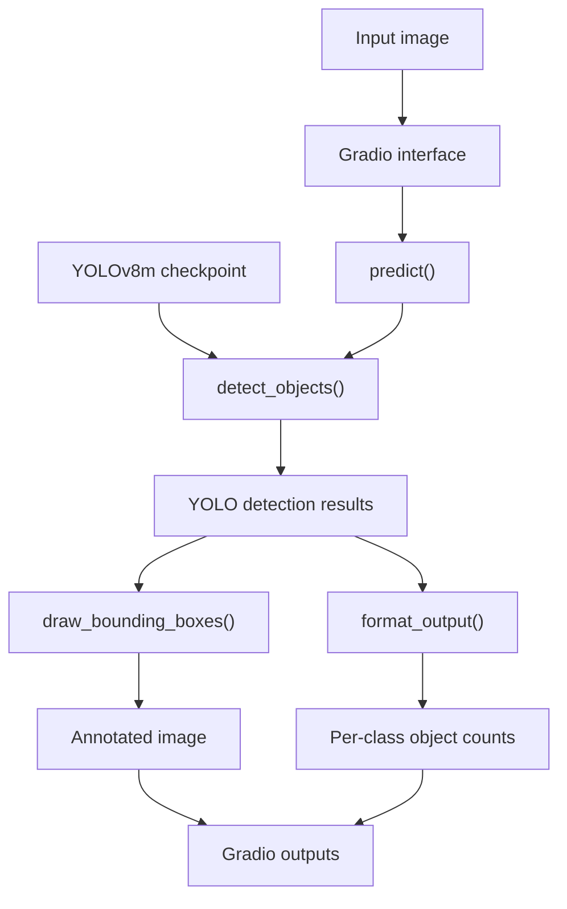

<div align="center">

# Object Detection with YOLOv8 & Gradio

**Detect objects, visualize their locations, and count instances — all from a single image.**

[](https://www.python.org/)
[](https://docs.ultralytics.com/models/yolov8/)
[](https://www.gradio.app/)
[](https://pytorch.org/)
[](https://docs.astral.sh/uv/)
[](LICENSE)

[Overview](#overview) · [Features](#features) · [Quick Start](#quick-start) · [How It Works](#how-it-works) · [Model](#model) · [Author](#author)

</div>

---

## Overview

Object Detection with YOLOv8 & Gradio is an interactive computer vision application that identifies and localizes multiple objects in a user-provided image. It integrates a pretrained **Ultralytics YOLOv8m** object detector with a browser-based **Gradio** interface, making deep learning inference accessible without requiring users to write code or interact with a command-line inference API.

The application transforms an input image into two complementary outputs: an annotated image showing the position, class, and confidence score of each detection, and a textual summary of the number of detected instances per class.

The project demonstrates an end-to-end machine learning inference workflow, from checkpoint management and image processing to prediction, visualization, and user interaction. No model training is required to get started.

## Features

- **Multi-object detection:** identify multiple instances and object categories within a single image using YOLOv8.
- **Visual localization:** overlay green bounding boxes, class labels, and confidence scores on a copy of the original image.
- **Instance counting:** aggregate predictions into a readable, per-class object count.
- **Interactive interface:** upload an image, run detection, and inspect the results directly in a browser.
- **Local-first model loading:** reuse an existing checkpoint, with a download fallback when the model is missing.
- **Custom styling:** Gradio Glass theme with a dark gradient background and cyan/magenta accents.
- **Reproducible environment:** Python 3.13, a committed `uv.lock`, and conventional pip-based installation support.

## Quick Start

### Prerequisites

- Python **3.13** (the version targeted by this repository).
- [Git](https://git-scm.com/downloads) and [Git LFS](https://git-lfs.com/) for downloading the model weights.
- [uv](https://docs.astral.sh/uv/getting-started/installation/) for the recommended setup, or pip as an alternative.
- An internet connection for the initial dependency and model downloads.

A dedicated GPU is not required for basic image inference, although compatible GPU acceleration can improve inference speed. Actual performance depends on the available hardware and PyTorch installation.

### 1. Clone the repository

Install Git LFS before cloning so that the full model checkpoint is retrieved rather than only its pointer file.

```bash
git lfs install
git clone https://github.com/aakrit1155/object-detection-gradio.git
cd object-detection-gradio
git lfs pull
```

### 2. Install dependencies and run the application

#### Option A — Using uv (recommended)

```bash
uv python install 3.13
uv sync --locked
uv run --locked python app.py
```

This creates the project environment and installs the dependency versions recorded in `uv.lock`. Manual virtual-environment activation is not necessary.

<details>
<summary><strong>Option B — Using pip and a virtual environment</strong></summary>

Create and activate a Python 3.13 virtual environment.

**Windows (Command Prompt)**

```bat
py -3.13 -m venv .venv
.venv\Scripts\activate.bat
```

**macOS / Linux**

```bash
python3.13 -m venv .venv
source .venv/bin/activate
```

Install the dependencies and start the application:

```bash
python -m pip install --upgrade pip
python -m pip install -r requirements.txt
python app.py
```

The requirements file does not pin package versions. For an environment matching the repository's recorded dependency resolution, prefer Option A. If a newer Gradio version causes compatibility issues with the existing interface, use the locked environment.

</details>

### 3. Open the application

Open the local URL printed in the terminal by Gradio, typically:

**[http://127.0.0.1:7860](http://127.0.0.1:7860)**

Keep the terminal running while using the application. Press `Ctrl+C` to stop the server.

## Usage

1. Provide an image in the **Upload an Image** component (for example, a JPG or PNG photograph).
2. Click **Detect Objects** to perform inference.
3. Examine **Image with Detected Objects** for bounding boxes, class names, and confidence scores.
4. Read **Detected Objects and Counts** for the number of predictions in each detected category.

### Example output

For an illustrative image containing people, cars, and a bicycle, the text summary might look like this:

```text
Person - 3
Car - 2
Bicycle - 1
```

Each detected instance also receives an individual annotation, such as `person 0.94`, on the output image. Here, `0.94` is the model's confidence score displayed to two decimal places, not a guarantee that the prediction is correct.

These values are illustrative; actual detections and confidence scores depend on the input image and model predictions.

## How It Works

The application loads the detection model once during startup and reuses it for subsequent inference requests. Gradio invokes the prediction pipeline when the user clicks the detection button.



### Inference pipeline

| Function | Responsibility |
| :--- | :--- |
| `detect_objects(image)` | Runs the loaded Ultralytics model and returns its detection results. |
| `draw_bounding_boxes(image, results)` | Converts NumPy input into a Pillow image when necessary and draws annotations on an image copy. |
| `format_output(results)` | Resolves class IDs to names and uses `collections.Counter` to aggregate detections. |
| `predict(image)` | Orchestrates inference and returns the annotated image together with the formatted count summary. |

Each detection provides bounding-box coordinates in `(x1, y1, x2, y2)` format, a class identifier, and a confidence score. The application maps class identifiers through the model's class-name dictionary and renders the corresponding annotations using Pillow's `ImageDraw`.

The object counts are calculated from the detections returned by the model, not from a separate counting network. Inference thresholds and duplicate-box suppression are handled by Ultralytics using its default prediction settings; the application does not expose these parameters in the UI.

## Model

### Default checkpoint

| Property | Details |
| :--- | :--- |
| Architecture | YOLOv8 (You Only Look Once, version 8) |
| Variant | YOLOv8m — Medium |
| Task | Object detection |
| Checkpoint | [`models/yolov8m.pt`](models/yolov8m.pt) |
| File size | Approximately 49.7 MB (as listed on GitHub) |
| Storage | Git Large File Storage (Git LFS) |
| Standard pretrained label space | 80 MS COCO object categories |

YOLOv8 is a single-stage object detector with an anchor-free detection head. The medium variant offers a compromise between computational cost and detection accuracy compared with the smaller and larger variants in the YOLOv8 family. The project uses the model for inference rather than training or fine-tuning.

### Model management

The application is configured to look for `models/yolov8m.pt` at startup. If the file exists, it is loaded directly. Otherwise, the application asks Ultralytics to load or download the named model and attempts to move the resulting checkpoint into the `models/` directory.

Run the application from the repository root and keep the `models/` directory present and writable for the fallback to work. If the file exists but is only a Git LFS pointer, retrieve the actual weights with `git lfs pull`.

### Changing the model

To experiment with another standard YOLOv8 detection checkpoint, change `MODEL_NAME` near the top of [`app.py`](app.py). For example:

```python
MODEL_NAME = "yolov8n.pt"
```

The following variants are available from Ultralytics. They are alternatives, not a claim that all five checkpoints are bundled in this repository.

| Variant | Filename | Relative trade-off |
| :--- | :--- | :--- |
| Nano | `yolov8n.pt` | Lowest computational demand |
| Small | `yolov8s.pt` | Lightweight inference |
| **Medium (default)** | **`yolov8m.pt`** | Intermediate accuracy and resource requirements |
| Large | `yolov8l.pt` | Higher computational demand |
| Extra Large | `yolov8x.pt` | Largest model in the standard detection family |

Restart the application after changing the checkpoint. Use trusted detection weights only; do not load arbitrary `.pt` files from untrusted sources.

See the [official YOLOv8 documentation](https://docs.ultralytics.com/models/yolov8/) for model specifications and published benchmarks. The repository does not report its own accuracy or latency benchmarks.

## Technology Stack

| Technology | Role |
| :--- | :--- |
| Python 3.13 | Application and inference logic |
| Ultralytics 8.3.114 | YOLOv8 model loading and prediction |
| PyTorch 2.6.0 / TorchVision 0.21.0 | Deep learning backend and vision operations |
| Gradio 5.25.2 | Browser-based interactive interface |
| NumPy | Image array representation |
| Pillow | Bounding-box and label rendering |
| CSS | Custom interface styling |
| uv | Dependency resolution and environment management |
| Git LFS | Versioning large model files |

The explicit package versions above refer to the committed lockfile, not necessarily the newest available releases.

## Project Structure

```text
object-detection-gradio/
├── models/                  # Model checkpoints
│   └── yolov8m.pt           # Verified default detection checkpoint (Git LFS)
├── app.py                   # Model loading, inference, rendering, and Gradio UI
├── style.css                # Custom UI styling
├── pyproject.toml           # Project metadata and dependency constraints
├── uv.lock                  # Locked dependency resolution
├── requirements.txt         # Alternative pip installation dependencies
├── runtime.txt              # Python runtime declaration
├── .python-version          # Python version used by the project
├── .gitattributes           # Git LFS configuration
├── .gitignore               # Git exclusion rules
├── LICENSE                  # Repository license
└── README.md                # Project documentation
```

## Limitations & Future Improvements

The current application is designed for single-image inference using a pretrained detector. It does not include a custom training pipeline, video tracking, live-stream processing, or a formal evaluation suite. Predictions may miss small, occluded, or unfamiliar objects, and the counts reflect model detections rather than verified ground truth. When no objects are detected, the current text summary is empty.

Potential extensions include:

- Confidence and IoU threshold controls, class filtering, and model selection in the interface.
- Video inference, multi-object tracking, and batch image processing.
- Exportable detection results in CSV or JSON, including coordinates and confidence scores.
- Explicit empty-input handling and clearer feedback when no detections are returned.
- Benchmarking accuracy and inference latency across model variants and hardware configurations.

## Troubleshooting

| Issue | Suggested resolution |
| :--- | :--- |
| Checkpoint fails to load after cloning | Install Git LFS, then run `git lfs install` and `git lfs pull` inside the repository. |
| Checkpoint is missing | Ensure `models/` exists, run from the project root, and allow the initial model download. |
| Gradio constructor or dependency errors | Use `uv sync --locked` and launch with `uv run --locked python app.py` to restore the recorded environment. |
| Slow inference | Try a smaller YOLOv8 detection variant or configure a compatible GPU-enabled PyTorch environment. |
| No detections shown | Try a clear image containing objects within the model's supported categories. |
| Default port is unavailable | Open the URL actually printed by Gradio in the terminal. |

## References & Acknowledgments

- [Ultralytics YOLOv8](https://docs.ultralytics.com/models/yolov8/) — model architecture and pretrained detection weights.
- [Ultralytics Prediction API](https://docs.ultralytics.com/modes/predict/) — inference and results representation.
- [Gradio](https://www.gradio.app/) — interactive machine learning application framework.
- [COCO Dataset](https://cocodataset.org/) — standard pretrained detection categories.
- [PyTorch](https://pytorch.org/) — deep learning framework.

## License

This repository includes an [Apache License 2.0](LICENSE). Third-party libraries and pretrained model weights have their own applicable licensing terms. In particular, consult the [Ultralytics licensing information](https://www.ultralytics.com/license) (AGPL-3.0 or Enterprise licensing) before redistribution or deployment; the repository's Apache license does not override those terms.

## Author

**Aakrit Sharma Lamsal**

Computer Vision · Machine Learning · AI Engineering · Software Development

[](https://github.com/aakrit1155)
[](https://aakrit-resume.streamlit.app)

---

<div align="center">

If you find this project useful, consider starring the repository on GitHub.

</div>
